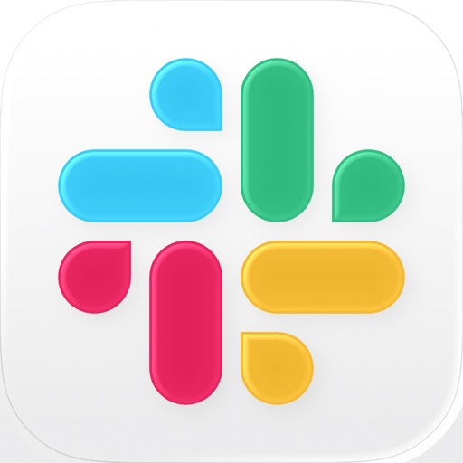

   
  
  
  
  

Introducing FaceNow, a desktop app that streams Xmax AI avatars into your video calls and live streams via a virtual camera. It delivers real-time, high-fidelity video transformation, letting you step into a completely new character on the fly using just a reference image and text prompts. Now that it’s open-source, you can easily extend it and build custom experiences for your own use cases.

 

## How It Works

- **Use XmaxSDK** to generate video from your camera feed in real time.
- **Use Virtual Camera** to send the generated video to other apps.
- **Use Virtual Microphone (optional)** to keep audio and video in sync.

 

## Application Scenarios

Any third-party apps that are compatible with the virtual camera interface, including WeChat, Zoom, Google Meet, Tencent Meeting, and so on.

  
  
  
  
  
  
  
  
  
  
  
  

 

## Getting Started

Set up FaceNow on [macOS](./macos/README.md) or [Windows](./windows/README.md) → Sign in with your Xmax API key → Customize your look and start generating → Select **FaceNow** as your camera in your meeting app

 

## Requirements

- **macOS** 13 or later.
- **Windows 11** (x64, or ARM64 via x64 emulation).
- **Xmax API Key**. Get your key by signing in to the Xmax API Platform.

 

## Ethical Use & Disclaimer

FaceNow is designed for creative expression, virtual collaboration, and entertainment. Users and developers are solely responsible for ensuring that their use of this software complies with all applicable local, national, and international laws.

| Topic | Details |
| --- | --- |
| **Consent&nbsp;First** | Do not use this tool to impersonate real individuals or generate likenesses without their explicit consent. |
| **Prohibited&nbsp;Uses** | Generating deceptive content, non-consensual media, or engaging in harassment, fraud, or any unlawful activities is strictly prohibited. |
| **No&nbsp;Liability** | The authors and contributors assume no responsibility for any misuse of the software or generated outputs. |

 

## License

FaceNow is licensed under the [MIT License](LICENSE).
